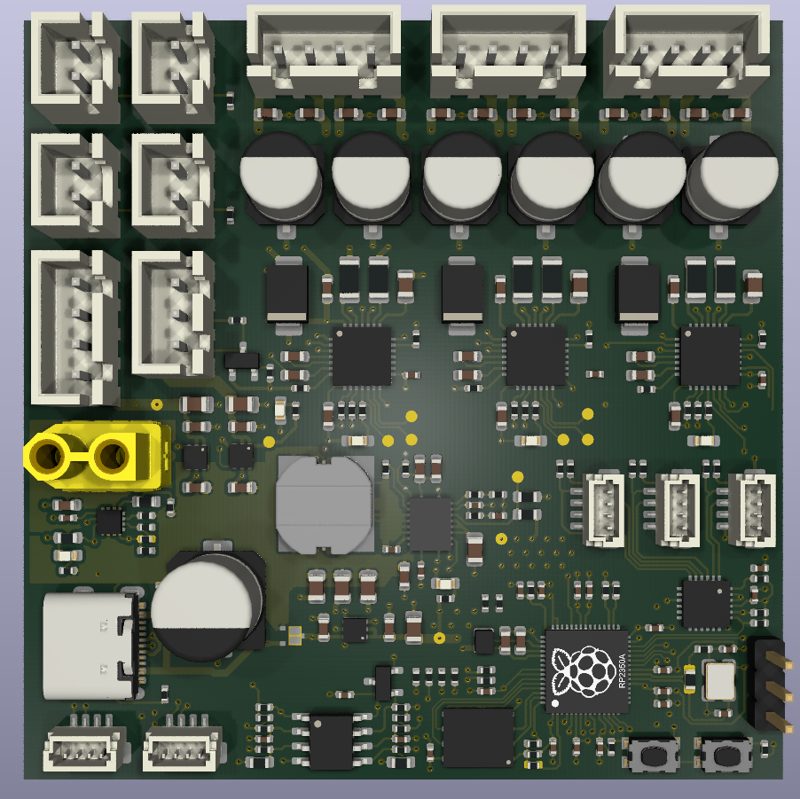

# ⚡ **PAMI_2026_A1** - KiCad Project

## 🌟 **Overview**

This repository contains the hardware design files for the **PAMI_2027** PCB, designed using **KiCad**.

This board consists of the basis of the PAMI. It is designed around the **Raspberry Pi Pico 2W** and has the following functions:
- Power supplies: 3.3V, 5V, 12V. Battery input: **2.7 - 13V**
- Triple stepper motor control
- Sensor inputs: accelerometer, LIDAR
- HMI extension connector + LCD connector

---

## 🏗️ **Hardware Design & Resources**

The hardware was designed using **KiCad**, an open-source electronics design automation suite.

### **Repository Contents**

Work in progress

---

## 📌 **Pin Assignment & Peripherals**

The following table details the pin assignments on the main **GPIO Header** for connecting external devices. This is crucial for writing firmware and connecting peripherals.

| Type | GPIO | Peripheral | Function | Signal Name | Description |
| :--- | :---: | :---: | :---: | :---: | :--- |
| **HMI** | **7** | Input | SIO | `DSI_STOP` | Display System Interface (DSI) Stop Signal |
| **HMI** | **9** | Input | SIO | `DSI_CORD` | DSI Cord Signal |
| **HMI** | **10** | Input | SIO | `DSI_TEAM` | DSI Team Signal |
| **HMI** | **11** | Output | SIO | `HMI_LCD_RES` | LCD Reset Pin |
| **HMI** | **12** | PWM | PWM6 A | `PWM_LED` | PWM Output for General LED Control |
| **HMI** | **13** | Output | SIO | `HMI_LCD_CS` | LCD Chip Select |
| **HMI** | **14** | PWM | PWM7 A | `PWM_S1` | PWM Output for Signal 1 |
| **HMI** | **15** | PWM | PWM7 B | `PWM_S2` | PWM Output for Signal 2 |
| **HMI** | **19** | PWM | PWM1 B | `HMI_LCD_DC` | LCD Data/Command Select |
| **HMI** | **20** | I2C | I2C0 SDA | `HMI_I2C_SDA` | I2C Data for HMI Peripherals |
| **HMI** | **21** | I2C | I2C0 SCL | `HMI_I2C_SCL` | I2C Clock for HMI Peripherals |
| **Internal** | **23** | Output | SIO | `WL_ON` | Wireless/Internal Power Switch Enable |
| **Internal** | **24** | Input | SIO | `WL_D` | Wireless Data/Status Input |
| **Internal** | **25** | Output | SIO | `WL_CS` | Wireless Chip Select |
| **Internal** | **29** | Input | SIO | `WL_CLK` | Wireless Clock Input |
| **Monitoring** | **26** | ADC | SIO | `VBAT / 3` | ADC Input for Battery Voltage (Divider x3) |
| **Monitoring** | **27** | ADC | SIO | *(Unassigned)* | Spare ADC Input |
| **Motor** | **0** | PWM | PWM0 A | `M3_STEP` | Motor 3 Stepping Signal |
| **Motor** | **1** | Output | SIO | `M3_DIR` | Motor 3 Direction Control |
| **Motor** | **8** | PWM | PWM4 A | `M1_DIR` | Motor 1 Direction Control |
| **Motor** | **16** | Output | SIO | `M2_DIR` | Motor 2 Direction Control |
| **Motor** | **17** | PWM | PWM0 B | `M2_STEP` | Motor 2 Stepping Signal |
| **Motor** | **18** | Output | SIO | `M_nEN` | Global Motor Driver Enable (Active Low) |
| **Motor** | **22** | PWM | PWM3 A | `M1_STEP` | Motor 1 Stepping Signal |
| **Sensor** | **2** | I2C | I2C1 SDA | `IMU_I2C_SDA` | I2C Data for IMU/External Sensors |
| **Sensor** | **3** | I2C | I2C1 SCL | `IMU_I2C_SCL` | I2C Clock for IMU/External Sensors |
| **Sensor** | **5** | Input | UART1 RX | `LIDAR_TX` | UART Receive from LIDAR (LIDAR TX is connected here) |
| **Sensor** | **6** | PWM | PWM3 A | `IMU_nINT` | IMU Interrupt Pin |
| **Spare** | **4** | N/A | N/A | *(Unassigned)* | Available GPIO Pin |
| **Spare** | **28** | N/A | N/A | *(Unassigned)* | Available GPIO Pin |

---
