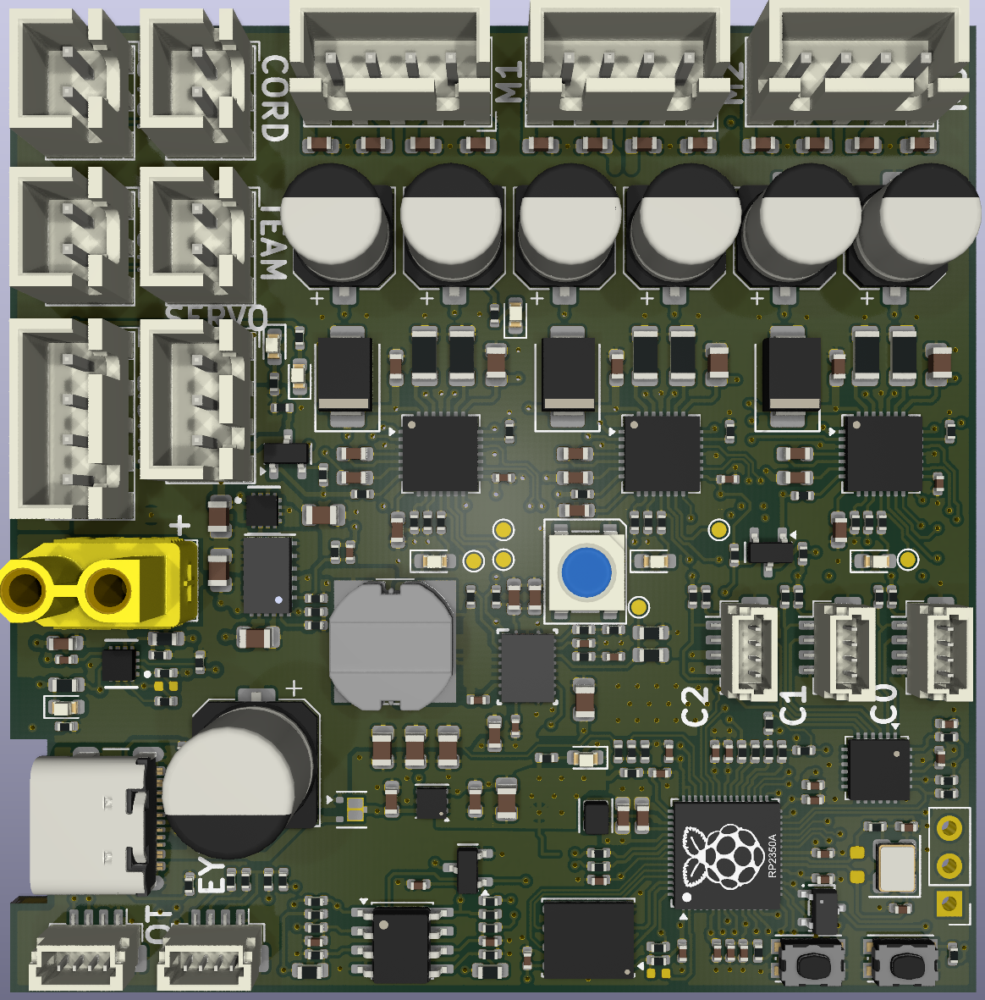

# ⚡ **PAMI_2027_A1** - KiCad Project

## 🌟 **Overview**

This repository contains the hardware design files for the **PAMI_2027_A1** PCB (Rev B1), designed using **KiCad 10**[cite: 3].

The board serves as the core control and power unit for the PAMI robot, built around the **Raspberry Pi Pico 2 / RP2350A** microcontroller[cite: 4]. Key features include:
- **Power Management:** Comprehensive power rails providing 3.3V, 5V, 5V_SW, and 12V_VMOT. Powered by a wide-input battery stage supporting 6V to 9V+ operation with reverse-polarity protection and ideal diode controllers[cite: 5].
- **Triple Stepper Motor Control:** Driven by dedicated **TMC2209-LA** drivers with UART communication config[cite: 7, 8, 9].
- **Sensor & Camera Expansion:** Integrated I2C camera multiplexer (`PCA9548ARGE`), LIDAR UART interface, and external sensor inputs[cite: 3, 9].
- **HMI & Discrete Inputs:** Opto-isolated/comparator-backed button inputs (`DSI_ON`, `DSI_STOP`, `DSI_CORD`, `DSI_TEAM`) via LM393[cite: 6].

---

## 🏗️ **Hardware Design & Resources**

The hardware was designed using **KiCad 10.0.1**[cite: 3]. 

### **Schematic Sheets Structure**
* **`0100_MCU.kicad_sch`**: Microcontroller core (RP2350A, W25Q128 external flash, decoupling, and header breakouts)[cite: 4].
* **`0200_Motors.kicad_sch`**: Triple TMC2209 stepper motor driver stages (`Motor1`, `Motor2`, `Motor3`)[cite: 7, 8, 9].
* **`0300_I2C_CAM.kicad_sch`**: PCA9548ARGE I2C bus switch/multiplexer for multi-camera management[cite: 9].
* **`0400_IOEXT.kicad_sch`**: I/O adaptation stage, LM393 button inputs, and WS2812B RGB LED driver[cite: 6].
* **`0500_Power.kicad_sch`**: Power architecture featuring LM73100 ideal diodes, MPM3630 5V regulator, TPS61088 12V boost converter, and TLV76733 3.3V LDO[cite: 5].

---

## 📌 **RP2350A Pin Assignment & Peripherals**

The following table details the pin assignments on the main **RP2350A MCU** for onboard subsystems and external peripherals[cite: 4].

| GPIO | Function / Subsystem | Signal Name | Description |
| :---: | :---: | :---: | :--- |
| **GPIO 0** | Motor | `M3_STEP` | Motor 3 Step Control[cite: 4] |
| **GPIO 1** | Motor | `M3_DIR` | Motor 3 Direction Control[cite: 4] |
| **GPIO 2** | Sensor (I2C1) | `I2C_OTOS_SDA` / `12C1_SDA` | I2C Data for Odometry/Sensors[cite: 4] |
| **GPIO 3** | Sensor (I2C1) | `I2C_OTOS_SCL` / `12C1_SCL` | I2C Clock for Odometry/Sensors[cite: 4] |
| **GPIO 5** | Sensor (UART0) | `LIDAR_UART_TX` | UART Receive from LIDAR[cite: 4] |
| **GPIO 7** | HMI / Input | `DSI_STOP` | Display System Interface Stop signal[cite: 4] |
| **GPIO 8** | Motor | `M1_DIR` | Motor 1 Direction Control[cite: 4] |
| **GPIO 9** | HMI / Input | `DSI_CORD` | DSI Cord signal[cite: 4] |
| **GPIO 10** | HMI / Input | `DSI_TEAM` | DSI Team signal[cite: 4] |
| **GPIO 11** | Motor / Diagnostic | `M_nEN` | Global Motor Driver Enable (Active Low)[cite: 4] |
| **GPIO 12** | Motor | `M2_DIR` | Motor 2 Direction Control[cite: 4] |
| **GPIO 13** | UART / Motor | `MOT_UART_TX` | TMC2209 Steppers UART Transmit[cite: 4] |
| **GPIO 14** | UART / Motor | `MOT_UART_RX` | TMC2209 Steppers UART Receive[cite: 4] |
| **GPIO 16** | I2C0 (CAM) | `I2C_CAM_SDA` | I2C Data for Camera Multiplexer (PCA9548)[cite: 4] |
| **GPIO 17** | I2C0 (CAM) | `I2C_CAM_SCL` | I2C Clock for Camera Multiplexer (PCA9548)[cite: 4] |
| **GPIO 19** | Motor | `M3_STEP` (Alt) / PWM | Motor 3 Step / PWM[cite: 4] |
| **GPIO 22** | Motor | `M1_STEP` | Motor 1 Step Control[cite: 4] |
| **GPIO 26 (ADC0)** | Monitoring | `VBAT_MEAS` | Battery Voltage Measurement (Scaled ADC)[cite: 4] |
| **GPIO 27 (ADC1)** | Monitoring | `PAMI_MEAS` | Current/System Measurement ADC[cite: 4] |
| **GPIO 28** | PWM / Output | `PWM_S1` | Signal 1 PWM Output[cite: 4] |
| **GPIO 29** | PWM / Output | `PWM_LED` | RGB LED / Status PWM Output[cite: 4] |

---